<p align="center">
  <picture>
    <source media="(prefers-color-scheme: dark)" srcset="assets/brand/Logo_HvPortal_White.png">
    
  </picture>
</p>

<h3 align="center">The web console your Hyper-V hosts were missing.</h3>

<p align="center">
  Inventory, browser console, VM changes, templates, backups, resource history and fine-grained permissions<br>
  for all your Hyper-V hosts, from one self-hosted portal. No System Center, no domain admin, no inbound ports on the hosts.
</p>

<p align="center">
  <a href="https://github.com/NEXQsrl/HvPortal/releases/latest"><b>Download the latest release</b></a> ·
  <a href="#install-in-ten-minutes">Install</a> ·
  <a href="#features">Features</a> ·
  <a href="INSTALL.md">Full guide</a> ·
  <a href="README_IT.md">Italiano</a>
</p>

<p align="center">
  
  
  
  
  <a href="LICENSE"></a>
  
</p>

<p align="center">
  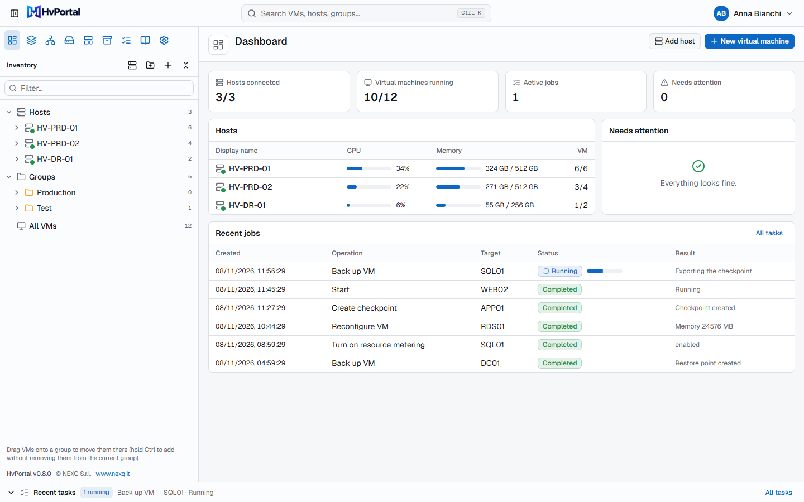
</p>

## Why HvPortal

Hyper-V is a great hypervisor, but managing more than a couple of hosts usually means Hyper-V Manager on a jump box,
PowerShell scripts, a separate backup product, and administrators with far more rights than they need. HvPortal gives
you what VMware administrators get from vCenter, for Hyper-V:

- **One place for every host and VM.** A live inventory of all your hosts, in a domain or in a workgroup, with the
  console, the settings and the history of each VM one click away.
- **Delegate safely.** Give a team its own folder of VMs, with quotas and the hosts, networks and storage it may use.
  Roles are assigned per host, group or VM; nobody can give more rights than they hold.
- **Every change is tracked.** Each operation is a task that is authorized, validated, followed to the end and written
  to a tamper-evident audit log. An outcome that cannot be verified is shown as such, never as a success.
- **Backups included.** Scheduled backups of VMs to a NAS or a local folder, verified copies, automatic restore tests,
  and restores of a whole VM, one disk or single files.
- **Failover clusters too.** Workgroup or domain, with or without Storage Spaces Direct: an agent on every node, so
  the portal keeps working when a node or its agent is down. Cluster health, capacity if a node is lost, safe node
  maintenance and highly available VMs.
- **Updates from the portal.** When GitHub has a newer release, an administrator installs it from Settings: the setup is
  checked (SHA-256 and signature) and installed by a local updater, keeping ports, names, certificate and data.
- **Know what your VMs really use.** Ten days of CPU, memory, disk and network history per VM, with charts that tell
  you what to look for.
- **Built on least privilege.** The agent on each host is only a member of *Hyper-V Administrators*, opens the
  connection itself (no inbound port on the host) and accepts a closed set of typed commands: there is no way to run an
  arbitrary script through the portal.

## See it

<table>
  <tr>
    <td width="50%">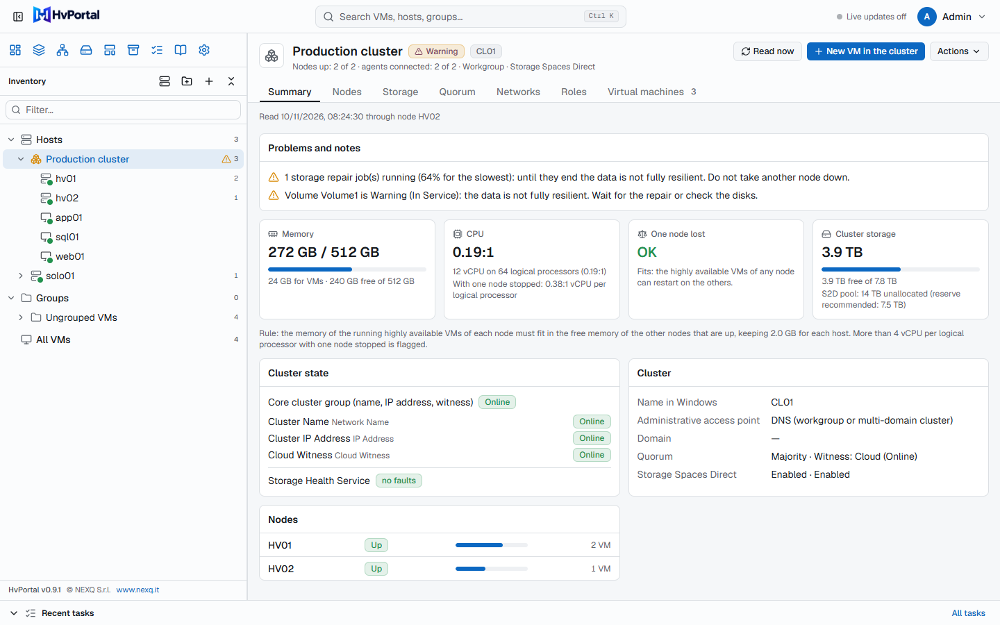<br><b>Failover cluster</b> (0.9): problems with what to do, capacity if a node is lost, cluster state (core resources, Health Service), nodes. VMs listed under the cluster.</td>
    <td width="50%">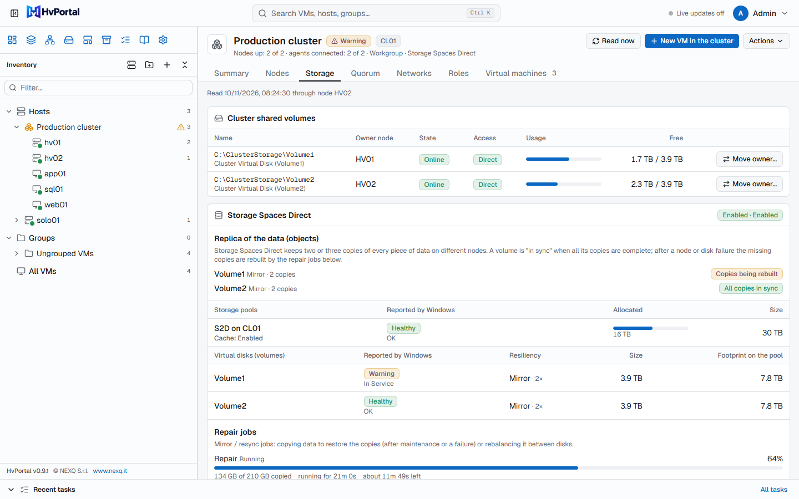<br><b>Cluster storage</b>: shared volumes and their owner node (movable), Storage Spaces Direct, copies of the data in sync or being rebuilt, repair jobs with time left.</td>
  </tr>
  <tr>
    <td width="50%">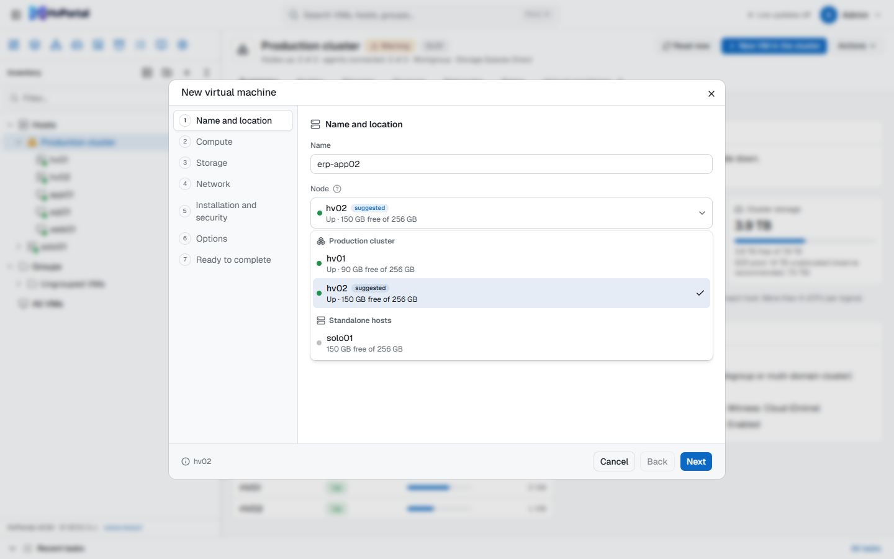<br><b>New VM in a cluster</b>: you choose the node, with its state, free memory and a suggestion.</td>
    <td width="50%">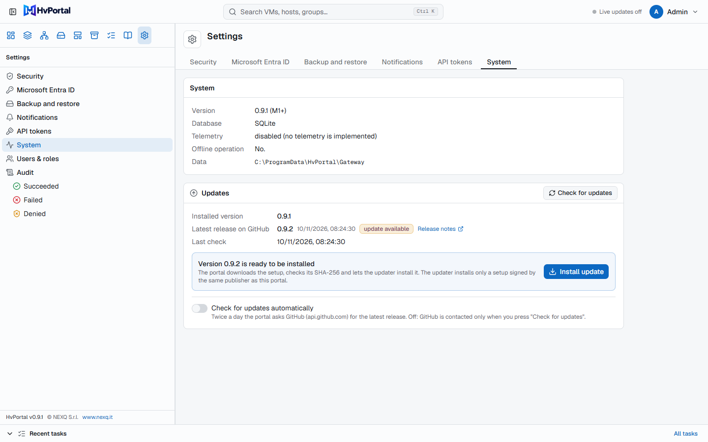<br><b>Updates</b> (0.9.1): the latest release on GitHub, installed from the portal; GitHub is contacted only when you ask.</td>
  </tr>
  <tr>
    <td width="50%">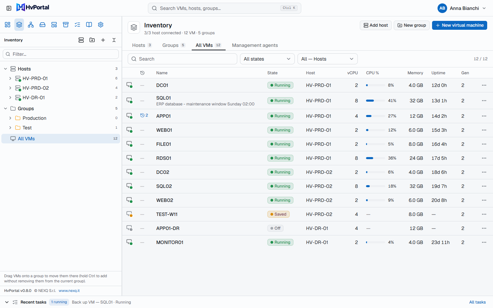<br><b>Inventory</b>: every VM of every host, with state, load, memory and uptime. Hosts, folders and all VMs in one tree.</td>
    <td width="50%">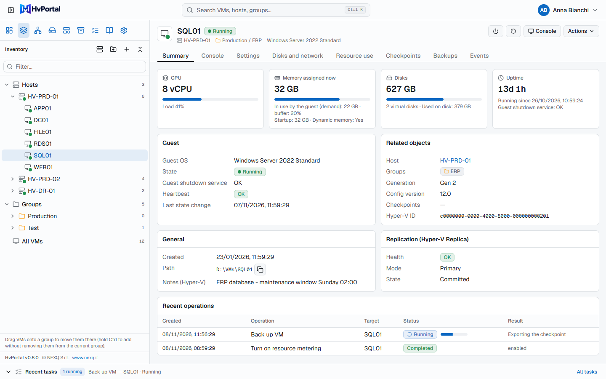<br><b>VM page</b>: summary, browser console, settings, disks and network, checkpoints, backups and events.</td>
  </tr>
  <tr>
    <td width="50%">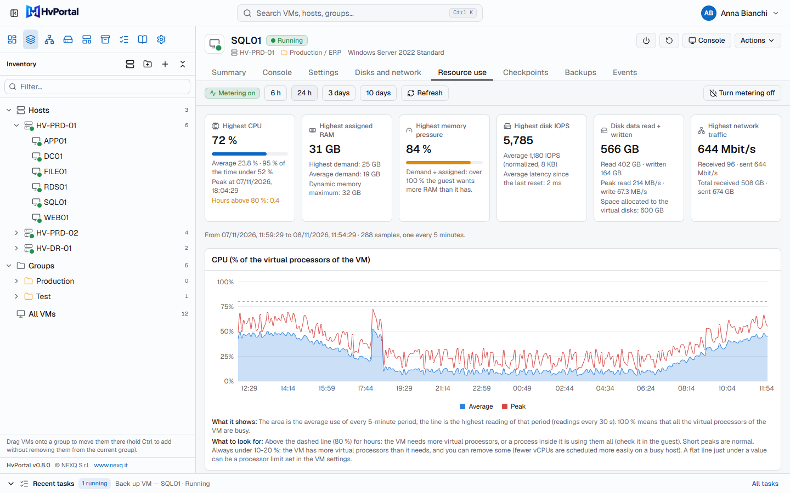<br><b>Resource use</b> (new in 0.8.0): peaks and averages, then explained charts of CPU, memory, pressure, IOPS, throughput and network.</td>
    <td width="50%">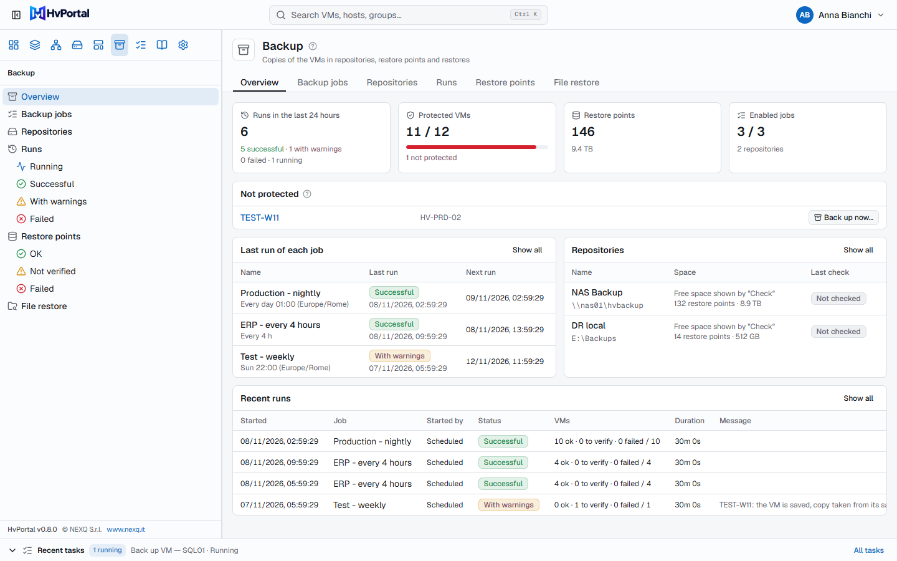<br><b>Backup</b>: protected VMs, last run of each job, repositories, restore points and file restore.</td>
  </tr>
  <tr>
    <td width="50%">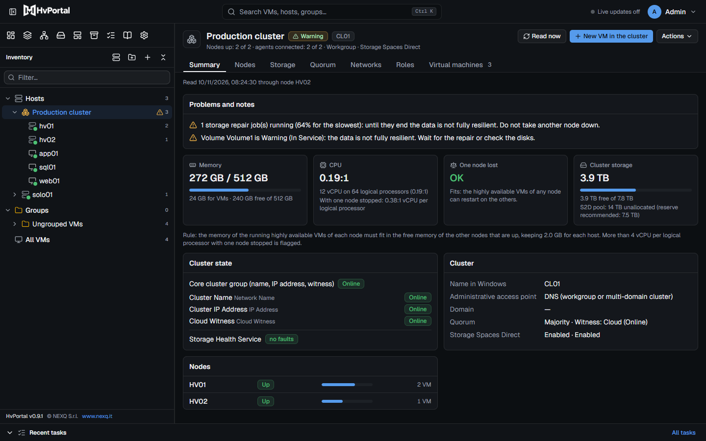<br><b>Light and dark theme</b>, English and Italian, built-in step-by-step guides.</td>
    <td width="50%">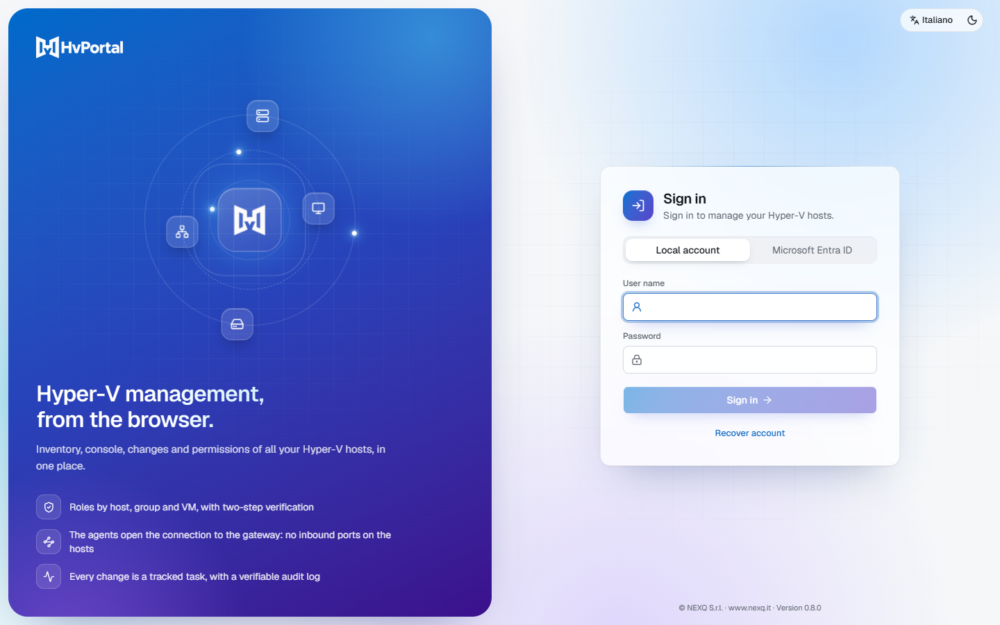<br><b>Sign-in</b> with local accounts and two-step verification, or with Microsoft Entra ID.</td>
  </tr>
</table>

<sub>The screenshots show the real interface (cluster and updates: version 0.9.1; the others: 0.8.0) with sample data (hosts, clusters, VMs and values are examples).</sub>

## Features

### Inventory, console and health
- **Live inventory** of all hosts: state, vCPU and load, memory and demand, uptime, heartbeat, guest OS, notes, Hyper-V
  Replica state. Changes made in Hyper-V Manager or PowerShell are detected and recorded.
- **Browser console**: the screen of the VM as Hyper-V sees it, with keyboard and mouse, also before the operating
  system starts and without network in the guest. It is the Hyper-V console, not an RDP session (low frame rate, no
  audio or clipboard: [details](docs/console.md)). Faster in 0.9.2: only the changed part of the screen is sent and
  keys are shown at once.
- **Host health**: hardware, physical disks, volumes and free space, storage pools, network adapters, recent hardware
  errors and Hyper-V services. What cannot be read is shown as unknown, never as healthy.
- **Resource use history** (0.8.0): Hyper-V resource metering turned on from the VM page, a sample every 5 minutes kept
  for 10 days, cards with the peaks (CPU, RAM, memory pressure, IOPS, disk data, network) and six charts, each with
  *what it shows* and *what to look for*.

### Failover clusters (0.9)
- **One agent per node, no single point of failure**: the cluster is read and managed through any node whose agent is
  connected. Workgroup clusters (DNS access point) work: no domain account, no stored credentials.
- **Cluster status with what to do**: nodes, quorum and witness, cluster networks, shared volumes (free space,
  redirected access), Storage Spaces Direct (pools, volumes, physical disks, repair jobs), roles and failed resources;
  checked every 2 minutes, with e-mail or webhook when it gets worse. A warning icon on the cluster and on the node in
  the tree, the problem written on the cluster and on the host page.
- **Cluster state and copies of the data** (0.9.1): the core cluster group (name, IP address, witness) and its
  resources, the faults reported by the Storage Spaces Direct Health Service, whether every volume has all its copies
  in sync, mirror/resync jobs with data copied, elapsed time and time left, and Storage Replica groups when present.
- **Capacity if a node is lost**: whether the highly available VMs of each node fit on the others (memory), vCPU per
  core with one node stopped, S2D pool reserve.
- **Node maintenance**: drain plus storage maintenance mode, and back with optional failback. Refused when the cluster
  cannot do without the node (another node down, repair running, witness offline, VMs that would not fit).
- **New VMs on the node you choose** (with a suggestion), **highly available** on a cluster shared volume; moves between
  nodes through the cluster; VMs moved by a failover keep their groups, permissions and history. VMs are listed under
  the cluster, not under the node that runs them now.
- **Owner of a shared volume** (0.9.1) moved from one node to another from the Storage tab.
- **Backups of cluster VMs to a NAS with credentials** (0.9.1): the backup staging folder set on every node at once,
  with a warning on the cluster and on the repository when a node has none.

### Virtual machines
- **Power**: start, guest shutdown and restart, turn off, reset, pause, resume, save.
- **Creation wizard**: generation 1 or 2, CPU, memory, disks, network and VLAN, ISO, Secure Boot and virtual TPM,
  location chosen in a folder browser.
- **Settings**: CPU, static or dynamic memory, firmware, new and expanded disks, DVD/ISO from the host's library,
  network adapters, name and notes. What Hyper-V cannot change on a running VM is refused, with the reason.
- **Checkpoints**, **templates** (a copy of the disks of a prepared VM; new VMs get their own name and resources) and
  **moves** (live migration to another host, with or without storage, or a storage move on the same host).
- **Delete** a VM keeping its disks, or also deleting its disk files, never touching files used by other VMs.

### Groups, permissions and limits
- **Folders of VMs**, nested, mirrored on the hosts as native Hyper-V VM groups.
- **Role-based access**: global, cluster, host, group or VM scope; deny by default, explicit deny wins. Built-in roles from
  *Platform administrator* to *Read only*, plus custom roles.
- **Limits per folder**: quotas (VMs, vCPU, memory, disk, private networks) and the hosts, networks and storage paths
  the folder may use, checked when an operation is requested and again when it runs.

### Networks and storage
- **Virtual switches** (External, Internal, Private) and **networks with VLAN**: pick a network, the switch and VLAN
  follow; change the VLAN of a network and re-tag the adapters already on it.
- **Host files**: browse, download, upload with SHA-256 check. **Storage folders** chosen at agent setup limit what the
  portal can see on a host.

### Backups
- **Repositories** on a NAS or SMB share (also outside the domain, with stored credentials) or in a local folder.
- **Jobs** for VMs and folders: daily, hourly or manual, with retention, copy verification (SHA-256) and notifications.
- **Restore** as a new VM or over the original, one disk, or single files from a disk mounted read-only.
- **Restore tests**: a restore point is restored isolated, started, checked through the guest heartbeat, then deleted.
- Based on Hyper-V checkpoints and exports, no extra software on the hosts or on the NAS. HvPortal says which kind of
  checkpoint Hyper-V really used and does not claim application-consistent backups ([how it works](docs/backup-restore.md)).

### Operations and integration
- **Notifications** by e-mail, Microsoft Teams, Slack or webhook; **read-only API tokens** for monitoring systems;
  **REST API** with OpenAPI ([docs/api.md](docs/api.md)).
- **Portal updates from GitHub** (0.9.1): check (on request, or twice a day if turned on) and install the new release
  from *Settings > System*. The setup is downloaded, its SHA-256 compared with the one published with the release, and
  installed by a Windows scheduled task only if signed by the same publisher as the installed portal
  ([how it works](INSTALL.md#9-updating)).
- **Agent updates from the portal** for signed releases, accepted only if signed by the same publisher.
- **Hosts without an agent** (optional), through a management agent with stored credentials.
- **Backup of the portal itself** from Settings, plus automatic daily copies of its database.

### Sign-in and audit
- **Local accounts** with passphrases and two-step verification (authenticator app, recovery codes), or **Microsoft
  Entra ID**. Sensitive actions ask for a confirmation; an unattended browser is signed out after 15 + 3 minutes.
- **Audit log** of every change and every refused attempt, HMAC-chained so that changes to stored entries can be
  detected; verifiable and exportable.

## Install in ten minutes

You need a Windows Server for the portal (the **gateway**; it can also run as a Linux container) and the
**agent** on each Hyper-V host. Hosts only need outbound access to the gateway.

**1. Download** `HvPortal.Gateway.Setup.exe` and `HvPortal.Agent.Setup.exe` from the
[latest release](https://github.com/NEXQsrl/HvPortal/releases/latest). The release notes list their SHA-256: check them
with `Get-FileHash <file> -Algorithm SHA256`.

**2. Trust the signature (once per server).** The files are signed by *NEXQ S.r.l.* with a self-signed certificate.
Windows trusts it only after you import it. The public certificate is inside the signature of the file; extract it,
check that its thumbprint is `989A5C82203AB19B6DB29FC447E8CB5EBEEB60D8`, then import it (elevated PowerShell):

```powershell
$cert = (Get-AuthenticodeSignature .\HvPortal.Gateway.Setup.exe).SignerCertificate
$cert.Thumbprint          # must be 989A5C82203AB19B6DB29FC447E8CB5EBEEB60D8
Export-Certificate -Cert $cert -FilePath .\HvPortal-CodeSigning.cer | Out-Null
Import-Certificate -FilePath .\HvPortal-CodeSigning.cer -CertStoreLocation Cert:\LocalMachine\Root
Import-Certificate -FilePath .\HvPortal-CodeSigning.cer -CertStoreLocation Cert:\LocalMachine\TrustedPublisher
```

Without this step the setups still run (*More info > Run anyway*), but agent updates from the portal need it. A
self-signed signature gives no SmartScreen or antivirus reputation.

**3. Install the gateway.** Run `HvPortal.Gateway.Setup.exe` on the management server: choose the names and addresses
browsers and agents will use (portal port 8443, agent port 8444). At the end the setup shows the portal address and a
**one-time setup token**.

**4. First sign-in.** Open the address (with the internal certificate the browser warns once, see
[INSTALL.md](INSTALL.md#4-portal-certificate-and-names)), enter the token, create the administrator and enroll an
authenticator app. There are no default credentials.

**5. Add a host.** In the portal choose **Add host > Agent on the host**, and copy the line *Data for the setup* (valid
15 minutes).

**6. Install the agent.** Run `HvPortal.Agent.Setup.exe` on the Hyper-V host, press **Paste from the portal** and
choose which local folders the portal may use. The host appears online within seconds.

**7. Invite your team.** In **Users & roles** create users (local or Microsoft) and assign roles on hosts, folders or
VMs. New users have no permissions until you give them some.

**Updating**: in *Settings > System > Updates* press *Check for updates*, then *Install update* (from 0.9.1; or run the
new gateway setup on the gateway), then update the agents from the portal (*Guide > Update the Windows services*) or with the new
agent setup. Everything else, including scripts for unattended installs, Docker, your own certificate,
backups and live-migration prerequisites, is in **[INSTALL.md](INSTALL.md)**.

### Requirements

| Component | Requirement |
|---|---|
| Gateway | Windows Server 64-bit (self-contained, no .NET to install; the graphical setup needs .NET Framework 4.7.2, included in Windows Server 2019+), or a Linux Docker host (`linux/amd64`) |
| Hyper-V hosts | Windows Server with the Hyper-V role and its PowerShell module; outbound TCP to the gateway's agent port. Domain membership not required. |
| Failover clusters | The agent on every node, installed with `-ClusterAccess Full` (or *Node of a failover cluster* in the setup); the Failover Clustering PowerShell module on the nodes ([install guide](INSTALL.md#5i-failover-clusters-also-workgroup-clusters-with-or-without-storage-spaces-direct)) |
| Browsers | Current Edge, Chrome or Firefox |
| Internet | Not required. Used only by what you turn on or ask for: Entra ID sign-in, SMTP, webhooks, update checks on GitHub |

Windows Server 2025 is the target platform, 2022 is under evaluation: see the
[compatibility matrix](docs/compatibility-matrix.md).

## How it works

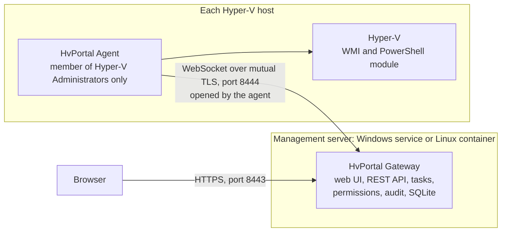

- The **gateway** runs as a non-administrator service account (`NT SERVICE\HvPortalGateway`) or a non-root container,
  and holds the web interface, the API, tasks, permissions, audit and the database.
- The **agent** runs on each host as `NT SERVICE\HvPortalAgent`, member of *Hyper-V Administrators* only, and connects
  to the gateway over mutual TLS with certificates from an internal CA.
- Commands are **closed and typed**: WMI for inventory, power and console; one fixed PowerShell script with typed
  parameters for management operations.

More: [architecture](docs/architecture.md), [design decisions](docs/decisions.md), [security model](docs/security-model.md).

## Project status

HvPortal 0.9.2 is a **preview**. It has a large automated test suite; the operations that need a real Hyper-V host are
tested against a test double of the agent, and the checks still to run on real hosts are listed in the
[real-host test plan](docs/verification/real-host-test-plan.md). Start in a lab or on non-critical hosts, and do not
expose the portal or the agent port to the Internet. HvPortal has not had an independent security review yet.
Failover cluster support (0.9) has not been validated on a real cluster yet (test plan V72–V81, V83), and the update
from the portal has not been run end to end on a real server yet (V82).

## Documentation

| Topic | Document |
|---|---|
| Installation, updates, uninstallation | [INSTALL.md](INSTALL.md), every option in [docs/install.md](docs/install.md) |
| Gateway in a Linux container | [docker/README.md](docker/README.md) |
| Backups and restores, backup of the portal | [docs/backup-restore.md](docs/backup-restore.md) |
| Troubleshooting | [docs/troubleshooting.md](docs/troubleshooting.md) |
| Security | [SECURITY.md](SECURITY.md), [docs/security-model.md](docs/security-model.md), [docs/threat-model.md](docs/threat-model.md) |
| REST API | [docs/api.md](docs/api.md), [docs/openapi/v1.json](docs/openapi/v1.json) |
| Architecture and decisions | [docs/architecture.md](docs/architecture.md), [docs/decisions.md](docs/decisions.md) |
| Hyper-V APIs and privileges | [docs/capability-matrix.md](docs/capability-matrix.md) |
| Tests and real-host verification | [docs/testing.md](docs/testing.md), [docs/verification/real-host-test-plan.md](docs/verification/real-host-test-plan.md) |
| Third-party licenses | [docs/licensing.md](docs/licensing.md) |

## Building from source

Prerequisites: Windows 10/11 or Windows Server, .NET SDK 10.0.204 (pinned by `global.json`), Node.js 22+, PowerShell 7.

```powershell
cd web; npm ci; npm run build; npx vitest run; cd ..     # web UI, written to src\HvPortal.Gateway\wwwroot
dotnet build HvPortal.slnx
dotnet test HvPortal.slnx
.\scripts\dev\Start-DevGateway.ps1 -Reset                  # dev gateway on https://localhost:18443
.\installer\Build-Release.ps1                              # release: artifacts\release\<version>\ (setups included)
```

Signed builds and the publication on GitHub are described in [INSTALL.md](INSTALL.md#1-get-the-release-files), the
container image in [docker/README.md](docker/README.md), the test suites in [docs/testing.md](docs/testing.md).

## Security

Least privilege everywhere: service accounts that are not administrators, agents that open the connection over mutual
TLS, a closed set of typed commands, deny by default, encrypted or hashed secrets, a chained audit log. No telemetry:
the gateway contacts external services only for what you configure (Entra ID, your SMTP server, your webhooks).
**To report a vulnerability, do not open a public issue**: follow [SECURITY.md](SECURITY.md).

## Contributing

Read [CONTRIBUTING.md](CONTRIBUTING.md) first. In short: never report a result that was not verified, authorize every
endpoint on the server (with a test for the refusal), never add a way to run arbitrary scripts on the hosts, never put
secrets in logs, and keep every user-visible text in both English and Italian.

## License

HvPortal is developed by [NEXQ](https://www.nexq.it/?utm_source=github&utm_medium=referral&utm_campaign=hvmanager) and released under the
**[PolyForm Shield License 1.0.0](https://polyformproject.org/licenses/shield/1.0.0)** ([LICENSE](LICENSE)), a standard
source-available license:

- **Free for personal and business use**, including production use in companies, with no limit on users, Hyper-V
  hosts, virtual machines or installations.
- **The source code is publicly available**: you can study it, modify it and build on it, and distribute copies with
  the license and the `Required Notice` line.
- **Reselling HvPortal is not allowed**: the license forbids providing any product that competes with HvPortal, so
  selling it, selling modified or renamed versions, or offering it as a competing product or service is not allowed.
- **Additional commercial rights**: contact NEXQ through [www.nexq.it](https://www.nexq.it/?utm_source=github&utm_medium=referral&utm_campaign=hvmanager).

It is not an OSI-approved open-source license (GitHub shows it as "Other"). Third-party components keep their own
licenses: see [NOTICE](NOTICE) and [docs/licensing.md](docs/licensing.md), which also explains how the noncompete
applies to paid services.

Copyright (c) NEXQ S.r.l. · [www.nexq.it](https://www.nexq.it/?utm_source=github&utm_medium=referral&utm_campaign=hvmanager)

"Hyper-V", "Windows Server" and "Microsoft Entra" are trademarks of the Microsoft group of companies. HvPortal is an
independent project and is not affiliated with or endorsed by Microsoft.
