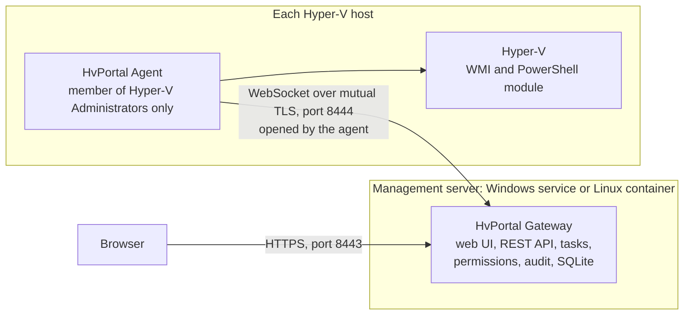

<p align="center">
  <picture>
    <source media="(prefers-color-scheme: dark)" srcset="assets/brand/Logo_HvPortal_White.png">
    
  </picture>
</p>

<p align="center"><b>English</b> | <a href="README_IT.md">Italiano</a></p>

# HvPortal

**Manage your Hyper-V hosts from a browser.** HvPortal is a self-hosted web portal for Microsoft Hyper-V, similar in
spirit to VMware vCenter. It gives you one inventory of all your hosts, a VM console in the browser, VM changes and
templates, backups, and fine-grained permissions with a tamper-evident audit log. It works with standalone Hyper-V
hosts, whether they are in an Active Directory domain or in a workgroup, and it never needs a domain administrator
account.

> **Preview, version 0.7.0.** HvPortal is pre-1.0 software. It has a large automated test suite, and operations that
> need a real Hyper-V host are tested against a test double of the agent. The checks that still have to be run on real
> hosts are listed in the [real-host test plan](docs/verification/real-host-test-plan.md). In particular, the
> features added in 0.7.0 (VM backups and restores, VM moves, host health, networks with VLANs and agent updates from
> the portal) have not yet been validated on production hosts. Try HvPortal in a lab or on non-critical hosts first.

## What HvPortal does

### Inventory, console and host health

- **One inventory for every host**: a single tree (Hosts, Groups, All VMs) showing each VM's state, resources, uptime,
  heartbeat, guest operating system, notes and replication state. Changes made outside the portal (in Hyper-V Manager
  or PowerShell) are detected and recorded.
- **Browser console**: the Hyper-V console of a VM, meaning the screen of the VM as the hypervisor sees it, with
  keyboard and mouse. It works before the operating system starts (firmware, setup, recovery) and without any network in
  the guest. It is not an RDP session. It has a low frame rate and no audio or clipboard ([details](docs/console.md)).
- **Host health**: hardware, physical disks, volumes and free space, storage pools, physical network adapters, recent
  storage and hardware errors from the event logs, and the Hyper-V services. A section the agent cannot read is shown as
  unreadable, never as healthy.

### Virtual machines

- **Power and lifecycle**: start, guest shutdown and restart, turn off, reset, pause, resume and save. You can also
  delete a VM: this removes its configuration from Hyper-V and keeps its disk files.
- **Creation wizard**: generation 1 or 2, CPU, memory, disks, network, ISO image, Secure Boot and virtual TPM, with the
  location chosen in a folder browser.
- **Settings**: CPU, memory (static or dynamic), firmware, new and expanded disks, DVD/ISO from the host's ISO library,
  network adapters, name and notes. A change that Hyper-V cannot make on a running VM is refused, with the reason.
- **Checkpoints**: create, apply and delete.
- **Templates**: a template is a copy of the disks of a prepared VM that is turned off. New VMs are created from it,
  each with its own name and resources.
- **Move**: live-migrate a VM to another host of the portal (with or without its storage), or move the files of a VM to
  another folder on the same host. HvPortal uses Hyper-V's own migration and does not change the hosts' migration
  settings ([prerequisites](INSTALL.md#8-before-moving-vms-between-hosts)).
- **Every change is a task**: a persistent job that is queued, authorized and validated again when it runs, and
  followed to the end. An outcome that cannot be verified is shown as *Not verified* or *Unknown outcome*, never as a
  success.

### Groups, permissions and limits

- **VM groups**: nested folders of VMs, mirrored on the hosts as native Hyper-V VM groups. The groups a host already
  has are imported automatically the first time, when that changes nothing in Hyper-V; the others can be imported on
  request.
- **Role-based access control**: roles are assigned at global, host, group or VM level. Access is denied unless a role
  allows it, an explicit deny always wins, and users cannot give themselves or others more rights than they hold.
  Built-in roles: Platform administrator, Infrastructure administrator, Folder administrator, VM operator, Backup
  operator, Auditor and Read only. Custom roles are supported.
- **Limits of a group**: quotas (VMs, vCPU, memory, disk, private networks) and the hosts, networks and storage paths
  that the group's users may use. They are checked when an operation is requested and again when it runs.

### Networks and storage

- **Virtual switches**: create and remove External, Internal and Private switches.
- **Networks with VLANs**: a portal network is a switch plus an access VLAN. Choosing a network for a VM's network
  adapter sets both. When you change the VLAN of a network, the adapters already on it can be re-tagged.
- **Host files**: browse host folders, download files, and upload files with a SHA-256 check. System folders are hidden
  and refused.
- **Storage folders**: when you install the agent you can limit it to chosen folders (`-StorageFolders`). The portal
  then sees nothing else on that host, and it cannot change the list.

### Backups

- **Repositories**: a local folder of a host, or an SMB share such as a NAS, optionally with credentials that are
  stored encrypted in the portal.
- **Backup jobs** for VMs and groups: daily, hourly or manual, with retention and verification of the copy. A single
  VM can also be backed up on demand.
- **Restore points**: each one is a full export of a checkpoint of the VM (a production checkpoint by default), with a
  SHA-256 for every file and a manifest.
- **Restores**: as a new VM or over the original VM; a single disk (which can be attached to a VM); or individual files,
  from a disk mounted read-only and downloaded through the portal.
- **Restore tests**: a restore point is periodically restored as an isolated VM (network adapters disconnected); the VM
  is started, checked for the guest heartbeat and then deleted.
- **What kind of copy this is**: a production checkpoint asks the guest to take part through the Hyper-V backup
  integration service (VSS in Windows guests). When the guest cannot take part, the copy is crash-consistent. HvPortal
  records which checkpoint type Hyper-V actually used when it can read it. It does not claim application-consistent
  backups.

### Operations and integration

- **Notifications**: e-mail (SMTP) and HTTPS webhooks (generic JSON, Microsoft Teams, Slack) for backup results, failed
  restore tests and outdated agents. They are off until you configure them.
- **API tokens**: read-only tokens that let monitoring systems read the backup status and recent runs. A token is shown
  once and stored only as a hash.
- **REST API** with an OpenAPI description ([docs/api.md](docs/api.md)).
- **Agent updates from the portal**: with a signed release, outdated agents can be updated from the portal. A host
  installs a package only if its signed catalog is signed with the same certificate as the agent already installed.
- **Hosts without an agent (optional)**: a *management agent* on a Windows server can reach hosts on which nothing is
  installed, using credentials stored encrypted in the portal. The agent on the host remains the recommended mode.
- **Backup of the portal itself**: a sealed backup file of the gateway (database, keys and internal CA) from Settings,
  a staged restore, and automatic daily copies of the database.

### Sign-in and audit

- **Local accounts** with long passphrases (at least 15 characters, checked against common passwords) and progressive
  delays instead of lockouts. Two-step verification with an authenticator app (TOTP) and recovery codes is required for
  administrators by default.
- **Microsoft Entra ID** sign-in for users created in the portal beforehand. MFA for these users is enforced by Entra
  ID, for example with Conditional Access.
- **Audit log** of every change and every refused attempt: who, how they signed in, what, and the outcome. The entries
  are chained with an HMAC, so changes to stored entries can be detected. The log can be verified and exported.
- **Web interface** in English and Italian, with a light and a dark theme and step-by-step guides built in.

## How it works



- The **gateway** is the control plane: web interface, REST API, real-time updates, sign-in, permissions, tasks, audit
  and the database (SQLite). On Windows it runs as the virtual account `NT SERVICE\HvPortalGateway`, which is not an
  administrator. It can also run as a non-root Linux container.
- The **agent** runs on each Hyper-V host as `NT SERVICE\HvPortalAgent`, a member of the local *Hyper-V Administrators*
  group only. The agent opens the connection to the gateway: a WebSocket protected by mutual TLS with certificates from
  an internal CA. The hosts need no inbound port.
- The agent accepts only a **closed set of typed commands**. Inventory, power operations and the console use WMI.
  Management operations go through one fixed PowerShell script with typed parameters. No command runs a script, a query
  or a path supplied by a caller.

More: [architecture](docs/architecture.md) and the [design decisions](docs/decisions.md).

## Requirements

| Component | Requirement |
|---|---|
| Gateway | Windows Server, 64-bit, or a Linux Docker host (`linux/amd64`). The release is self-contained, so no .NET runtime needs to be installed. The graphical setup needs .NET Framework 4.7.2, which is part of Windows Server 2019 and later. |
| Hyper-V hosts | Windows Server with the Hyper-V role and the Hyper-V PowerShell module, and outbound TCP to the gateway's agent port. Domain membership is not required. |
| Browsers | Current Edge, Chrome or Firefox. |
| Internet | Not required. Only the features you enable use it: Microsoft Entra ID sign-in, and SMTP or webhooks for notifications. |
| Optional | A code-signing certificate, for signed builds and for agent updates from the portal. |

Windows Server 2025 is the target platform; Windows Server 2022 is under evaluation. A platform is declared supported
only after the real-host tests pass on it: see the [compatibility matrix](docs/compatibility-matrix.md).

## Quick start

1. **Get the release files**: build them (see [Building from source](#building-from-source)), or use the release files
   published by the maintainers, if any.
2. **Install the gateway**: run `HvPortal.Gateway.Setup.exe` on the management server. At the end it shows the portal
   address and a one-time setup token.
3. **Sign in for the first time**: enter the token, create the administrator and enroll an authenticator app.
4. **Add a host**: in the portal choose **Add host**, download the agent setup and copy the line *Data for the setup*
   (it is valid for 15 minutes).
5. **Install the agent**: run `HvPortal.Agent.Setup.exe` on the Hyper-V host and press *Paste from the portal*. The host
   appears online within seconds.
6. **Give access**: in **Users & roles**, create users and assign roles. New users have no permissions.

The complete procedure, including the PowerShell scripts, Docker, certificates, updates and the prerequisites for
backups and live migration, is in **[INSTALL.md](INSTALL.md)**.

## Building from source

Prerequisites: Windows 10/11 or Windows Server; .NET SDK 10.0.204 (pinned by `global.json`; later feature bands are
accepted); Node.js 22 or later; PowerShell 7 for the release script.

```powershell
# Web interface (the build is written to src\HvPortal.Gateway\wwwroot)
cd web; npm ci; npm run build; npx vitest run; cd ..

# Gateway, agent and tests
dotnet build HvPortal.slnx
dotnet test HvPortal.slnx

# Development gateway: https://localhost:18443 (agent port 18444), no administrator rights needed.
# The setup token is in %LOCALAPPDATA%\HvPortal\dev-gateway\bootstrap\setup-token.txt
.\scripts\dev\Start-DevGateway.ps1 -Reset
```

Release build (tests, self-contained gateway and agent, graphical setups, agent package, SHA-256 checksums):

```powershell
.\installer\Build-Release.ps1                     # output: artifacts\release\<version>\
# Signed build, for example with a self-signed certificate (only the public .cer is exported):
.\installer\New-CodeSigningCertificate.ps1         # prints the thumbprint
.\installer\Build-Release.ps1 -SigningCertificateThumbprint <thumbprint>
```

Gateway container image (built from the repository; no prebuilt image is published):

```powershell
docker build --provenance=false --sbom=false --platform linux/amd64 -f docker/Dockerfile -t hvportal-gateway:0.7.0 .
```

The test suites and the browser end-to-end test are described in [docs/testing.md](docs/testing.md).

## Documentation

| Topic | Document |
|---|---|
| Installation, updates, uninstallation | [INSTALL.md](INSTALL.md), with every option in [docs/install.md](docs/install.md) |
| Gateway in a Linux container | [docker/README.md](docker/README.md) |
| Troubleshooting | [docs/troubleshooting.md](docs/troubleshooting.md) |
| Backup and restore of the portal itself | [docs/backup-restore.md](docs/backup-restore.md) |
| Architecture and design decisions | [docs/architecture.md](docs/architecture.md), [docs/decisions.md](docs/decisions.md) |
| Security | [SECURITY.md](SECURITY.md), [docs/security-model.md](docs/security-model.md), [docs/threat-model.md](docs/threat-model.md) |
| REST API | [docs/api.md](docs/api.md), [docs/openapi/v1.json](docs/openapi/v1.json) |
| Browser console | [docs/console.md](docs/console.md), [docs/console-study.md](docs/console-study.md) |
| Hyper-V APIs used and privileges needed | [docs/capability-matrix.md](docs/capability-matrix.md) |
| Supported platforms | [docs/compatibility-matrix.md](docs/compatibility-matrix.md) |
| Requirements and roadmap | [docs/requirements.md](docs/requirements.md), [docs/roadmap.md](docs/roadmap.md) |
| Tests and real-host verification | [docs/testing.md](docs/testing.md), [docs/verification/real-host-test-plan.md](docs/verification/real-host-test-plan.md) |
| Licenses of third-party components | [docs/licensing.md](docs/licensing.md) |

## Security

HvPortal is built on least privilege. The services run under dedicated accounts that are not administrators. The
agents open the connection to the gateway over mutual TLS. The command set is closed and typed. Access is denied by
default. Secrets are encrypted or stored only as hashes, and every change is written to a chained audit log. The
release can be signed, but a self-signed signature does not make a build trusted. The summary is in
[SECURITY.md](SECURITY.md).

HvPortal has not had an independent security review yet. Do not expose the portal or the agent port to the Internet.

**To report a vulnerability, do not open a public issue**: follow [SECURITY.md](SECURITY.md).

## Contributing

Read [CONTRIBUTING.md](CONTRIBUTING.md) first. In short: never report a result that was not verified, authorize
every endpoint on the server (with a test for the refusal), never add a way to run arbitrary scripts on the hosts,
never put secrets in logs, and keep every user-visible text in both English and Italian.

## License

> **License: to be chosen by the maintainers.** This repository does not contain a `LICENSE` file yet.
> [docs/licensing.md](docs/licensing.md) describes the license under consideration and lists the licenses of the
> third-party components. Until a license file is added, no license is granted by this repository.

Copyright (c) NEXQ S.r.l.

## Trademarks and privacy

"Hyper-V", "Windows Server" and "Microsoft Entra" are trademarks of the Microsoft group of companies. HvPortal is an
independent project and is not affiliated with or endorsed by Microsoft.

HvPortal has no telemetry. The gateway contacts external services only for the features you configure: Microsoft
Entra ID sign-in, your SMTP server and your webhooks.
