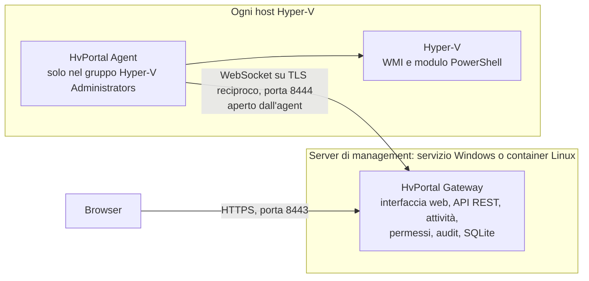

<p align="center">
  <picture>
    <source media="(prefers-color-scheme: dark)" srcset="assets/brand/Logo_HvPortal_White.png">
    
  </picture>
</p>

<p align="center"><a href="README.md">English</a> | <b>Italiano</b></p>

# HvPortal

**Gestisci i tuoi host Hyper-V dal browser.** HvPortal è un portale web per Microsoft Hyper-V da installare sui propri
server, pensato sul modello di VMware vCenter. Offre un unico inventario di tutti gli host, la console delle VM nel
browser, modifiche e template delle VM, backup e permessi granulari, con un registro di audit che rende visibili le
manomissioni. Funziona con host Hyper-V standalone, sia in un dominio Active Directory sia in workgroup, e non richiede
mai un account di amministratore di dominio.

> **Anteprima, versione 0.7.0.** HvPortal non è ancora alla versione 1.0. Ha un'ampia suite di test automatici, e le
> operazioni che richiedono un vero host Hyper-V sono provate con un agent simulato. Le verifiche ancora
> da eseguire su host reali sono elencate nel [piano di test su host reali](docs/verification/real-host-test-plan.md).
> In particolare, le funzioni introdotte nella 0.7.0 (backup e ripristino delle VM, spostamento delle VM, stato di
> salute degli host, reti con VLAN e aggiornamento degli agent dal portale) non sono ancora state validate su host di
> produzione. Prova HvPortal prima in laboratorio o su host non critici.

## Che cosa fa HvPortal

### Inventario, console e stato degli host

- **Un solo inventario per tutti gli host**: un unico albero (Host, Gruppi, Tutte le VM) che mostra di ogni VM stato,
  risorse, tempo di attività, heartbeat, sistema operativo guest, note e stato della replica. Le modifiche fatte fuori
  dal portale (in Hyper-V Manager o in PowerShell) vengono rilevate e registrate.
- **Console nel browser**: la console Hyper-V della VM, cioè lo schermo della VM così come lo vede l'hypervisor, con
  tastiera e mouse. Funziona prima che parta il sistema operativo (firmware, installazione, ripristino) e anche se il
  guest non ha rete. Non è una sessione RDP. Ha una frequenza di aggiornamento bassa e non offre audio né appunti
  ([dettagli](docs/console.md)).
- **Stato di salute degli host**: hardware, dischi fisici, volumi e spazio libero, pool di archiviazione, schede di rete
  fisiche, errori recenti di archiviazione e hardware dai registri eventi, servizi Hyper-V. Una sezione che l'agent non
  riesce a leggere viene mostrata come non leggibile, mai come sana.

### Macchine virtuali

- **Alimentazione e ciclo di vita**: avvio, arresto e riavvio del guest, spegnimento forzato, reset, pausa, ripresa e
  salvataggio dello stato. Puoi anche eliminare una VM: viene rimossa la sua configurazione da Hyper-V e restano i file
  dei dischi.
- **Creazione guidata**: generazione 1 o 2, CPU, memoria, dischi, rete, immagine ISO, Secure Boot e TPM virtuale, con la
  posizione scelta da un selettore di cartelle.
- **Impostazioni**: CPU, memoria (statica o dinamica), firmware, dischi nuovi ed espansi, DVD/ISO dalla libreria ISO
  dell'host, schede di rete, nome e note. Una modifica che Hyper-V non può applicare a una VM accesa viene rifiutata,
  con il motivo.
- **Checkpoint**: creazione, applicazione ed eliminazione.
- **Template**: un template è una copia dei dischi di una VM preparata e spenta. Da un template si creano nuove VM,
  ognuna con il proprio nome e le proprie risorse.
- **Spostamento**: migrazione in tempo reale di una VM verso un altro host del portale (con o senza i suoi file), oppure
  spostamento dei file di una VM in un'altra cartella dello stesso host. HvPortal usa la migrazione di Hyper-V e non
  modifica le impostazioni di migrazione degli host ([prerequisiti](INSTALL_IT.md#8-prima-di-spostare-le-vm-tra-host)).
- **Ogni modifica è un'attività**: viene messa in coda, autorizzata e validata di nuovo al momento dell'esecuzione e
  seguita fino alla fine. Quando l'esito non si può verificare, l'attività viene mostrata come *Non verificata* o con
  *Esito sconosciuto*, mai come riuscita.

### Gruppi, permessi e limiti

- **Gruppi di VM**: cartelle annidate di VM, replicate sugli host come gruppi di VM nativi di Hyper-V. I gruppi già
  presenti su un host vengono importati automaticamente la prima volta, se questo non cambia nulla in Hyper-V; gli
  altri si possono importare su richiesta.
- **Controllo degli accessi basato sui ruoli**: i ruoli si assegnano a livello globale, di host, di gruppo o di VM.
  L'accesso è negato se nessun ruolo lo consente, un divieto esplicito prevale sempre e nessuno può dare a sé stesso o
  ad altri più diritti di quelli che ha. Ruoli predefiniti (il portale li mostra con il nome inglese): Platform
  administrator, Infrastructure administrator, Folder administrator, VM operator, Backup operator, Auditor e Read
  only. Sono supportati anche ruoli personalizzati.
- **Limiti di un gruppo**: quote (VM, vCPU, memoria, disco, reti private) e gli host, le reti e i percorsi di
  archiviazione che gli utenti del gruppo possono usare. Vengono controllati quando un'operazione viene richiesta e di
  nuovo quando viene eseguita.

### Reti e archiviazione

- **Switch virtuali**: creazione e rimozione di switch esterni, interni e privati.
- **Reti con VLAN**: una rete del portale è uno switch più una VLAN di accesso. Scegliendo una rete per la scheda di
  rete di una VM si impostano entrambi. Quando cambi la VLAN di una rete, le schede già collegate possono essere
  aggiornate.
- **File degli host**: esplorazione delle cartelle, download e upload di file con verifica SHA-256. Le cartelle di
  sistema sono nascoste e rifiutate.
- **Cartelle di storage**: quando installi l'agent puoi limitarlo a cartelle scelte (`-StorageFolders`). Il portale
  allora non vede nient'altro su quell'host e non può modificare l'elenco.

### Backup

- **Repository**: una cartella locale di un host oppure una condivisione SMB, ad esempio un NAS, eventualmente con
  credenziali conservate cifrate nel portale.
- **Job di backup** per VM e gruppi: giornalieri, orari o manuali, con conservazione e verifica della copia. Una
  singola VM si può anche salvare al momento.
- **Punti di ripristino**: ognuno è un'esportazione completa di un checkpoint della VM (per impostazione predefinita
  un checkpoint di produzione), con lo SHA-256 di ogni file e un manifest.
- **Ripristini**: come nuova VM o sopra la VM originale; di un singolo disco (che si può collegare a una VM); oppure di
  singoli file, da un disco montato in sola lettura e scaricati attraverso il portale.
- **Test di ripristino**: periodicamente un punto di ripristino viene ripristinato come VM isolata (con le schede di
  rete scollegate); la VM viene avviata, controllata tramite l'heartbeat del guest e poi eliminata.
- **Che tipo di copia è**: un checkpoint di produzione chiede al guest di partecipare tramite il servizio di
  integrazione di backup di Hyper-V (VSS nei guest Windows). Quando il guest non può partecipare, la copia è
  coerente solo come dopo un arresto improvviso (crash-consistent). HvPortal registra quale tipo di checkpoint ha
  effettivamente usato Hyper-V, quando riesce a leggerlo. Non dichiara backup coerenti a livello applicativo.

### Gestione e integrazione

- **Notifiche**: e-mail (SMTP) e webhook HTTPS (JSON generico, Microsoft Teams, Slack) per gli esiti dei backup, i test
  di ripristino falliti e gli agent non aggiornati. Restano disattivate finché non le configuri.
- **Token API**: token di sola lettura con cui i sistemi di monitoraggio leggono lo stato dei backup e le esecuzioni
  recenti. Un token viene mostrato una sola volta e conservato solo come hash.
- **API REST** con descrizione OpenAPI ([docs/api.md](docs/api.md)).
- **Aggiornamento degli agent dal portale**: con una release firmata, gli agent non aggiornati si possono aggiornare
  dal portale. Un host installa un pacchetto solo se il suo catalogo è firmato con lo stesso certificato dell'agent
  già installato.
- **Host senza agent (facoltativo)**: un *agent di management* su un server Windows può raggiungere host su cui non è
  installato nulla, con credenziali conservate cifrate nel portale. L'agent sull'host resta la modalità consigliata.
- **Backup del portale stesso**: un file di backup sigillato del gateway (database, chiavi e CA interna) dalle
  Impostazioni, un ripristino preparato in anticipo e applicato al riavvio, e copie automatiche giornaliere del
  database.

### Accesso e audit

- **Account locali** con passphrase lunghe (almeno 15 caratteri, confrontate con un elenco di password comuni) e
  ritardi progressivi al posto dei blocchi. La verifica in due passaggi con un'app di autenticazione (TOTP) e codici di
  recupero è obbligatoria per gli amministratori per impostazione predefinita.
- **Accesso con Microsoft Entra ID** per gli utenti creati prima nel portale. L'MFA di questi utenti è gestita da Entra
  ID, ad esempio con l'accesso condizionale.
- **Registro di audit** di ogni modifica e di ogni tentativo rifiutato: chi, come ha fatto l'accesso, che cosa e con
  quale esito. Le voci sono concatenate con un HMAC, quindi le modifiche alle voci salvate si possono rilevare. Il
  registro si può verificare ed esportare.
- **Interfaccia web** in italiano e in inglese, con tema chiaro e scuro e guide passo passo integrate.

## Come funziona



- Il **gateway** è il piano di controllo: interfaccia web, API REST, aggiornamenti in tempo reale, accesso, permessi,
  attività, audit e database (SQLite). Su Windows gira con l'account virtuale `NT SERVICE\HvPortalGateway`, che non è
  amministratore. Può anche girare come container Linux senza privilegi di root.
- L'**agent** gira su ogni host Hyper-V come `NT SERVICE\HvPortalAgent`, membro del solo gruppo locale *Hyper-V
  Administrators*. È l'agent ad aprire la connessione verso il gateway: un WebSocket protetto da TLS reciproco, con
  certificati di una CA interna. Gli host non hanno bisogno di porte in ingresso.
- L'agent accetta solo un **insieme chiuso di comandi tipizzati**. Inventario, alimentazione e console usano WMI. Le
  operazioni di gestione passano da un unico script PowerShell fisso con parametri tipizzati. Nessun comando esegue
  uno script, una query o un percorso forniti da chi chiama.

Approfondimenti: [architettura](docs/architecture.md) e [decisioni di progetto](docs/decisions.md) (in inglese).

## Requisiti

| Componente | Requisito |
|---|---|
| Gateway | Windows Server a 64 bit, oppure un host Docker Linux (`linux/amd64`). La release è autonoma: non serve installare il runtime .NET. Il setup grafico richiede .NET Framework 4.7.2, incluso in Windows Server 2019 e successivi. |
| Host Hyper-V | Windows Server con il ruolo Hyper-V e il modulo PowerShell Hyper-V, e traffico TCP in uscita verso la porta degli agent del gateway. L'appartenenza a un dominio non è richiesta. |
| Browser | Edge, Chrome o Firefox in versione aggiornata. |
| Internet | Non serve. La usano solo le funzioni che attivi: l'accesso con Microsoft Entra ID, e SMTP o webhook per le notifiche. |
| Facoltativo | Un certificato di firma del codice, per le build firmate e per l'aggiornamento degli agent dal portale. |

La piattaforma di riferimento è Windows Server 2025; Windows Server 2022 è in valutazione. Una piattaforma viene
dichiarata supportata solo dopo che i test su host reali sono stati superati: vedi la
[matrice di compatibilità](docs/compatibility-matrix.md).

## Avvio rapido

1. **Procurati i file della release**: compilali tu (vedi [Compilare dai sorgenti](#compilare-dai-sorgenti)),
   oppure usa i file di release pubblicati dai manutentori, se ce ne sono.
2. **Installa il gateway**: avvia `HvPortal.Gateway.Setup.exe` sul server di management. Alla fine mostra l'indirizzo
   del portale e un token di setup monouso.
3. **Fai il primo accesso**: inserisci il token, crea l'amministratore e configura un'app di autenticazione.
4. **Aggiungi un host**: nel portale scegli **Aggiungi host**, scarica il setup dell'agent e copia la riga
   *Dati per il setup* (vale 15 minuti).
5. **Installa l'agent**: avvia `HvPortal.Agent.Setup.exe` sull'host Hyper-V e premi *Incolla dal portale*. In pochi
   secondi l'host risulta online.
6. **Dai gli accessi**: in **Utenti e ruoli** crea gli utenti e assegna i ruoli. I nuovi utenti non hanno alcun
   permesso.

La procedura completa, con gli script PowerShell, Docker, i certificati, gli aggiornamenti e i prerequisiti per backup
e migrazione in tempo reale, è in **[INSTALL_IT.md](INSTALL_IT.md)**.

## Compilare dai sorgenti

Prerequisiti: Windows 10/11 o Windows Server; .NET SDK 10.0.204 (fissato da `global.json`, che accetta anche feature
band successive); Node.js 22 o successivo; PowerShell 7 per lo script di release.

```powershell
# Interfaccia web (la build viene scritta in src\HvPortal.Gateway\wwwroot)
cd web; npm ci; npm run build; npx vitest run; cd ..

# Gateway, agent e test
dotnet build HvPortal.slnx
dotnet test HvPortal.slnx

# Gateway di sviluppo: https://localhost:18443 (porta agent 18444), senza diritti di amministratore.
# Il token di setup è in %LOCALAPPDATA%\HvPortal\dev-gateway\bootstrap\setup-token.txt
.\scripts\dev\Start-DevGateway.ps1 -Reset
```

Build di release (test, gateway e agent autonomi, setup grafici, pacchetto dell'agent, checksum SHA-256):

```powershell
.\installer\Build-Release.ps1                     # risultato: artifacts\release\<versione>\
# Build firmata, ad esempio con un certificato self-signed (viene esportato solo il .cer pubblico):
.\installer\New-CodeSigningCertificate.ps1         # stampa l'impronta (thumbprint)
.\installer\Build-Release.ps1 -SigningCertificateThumbprint <thumbprint>
```

Immagine container del gateway (si compila dal repository; non è pubblicata nessuna immagine pronta):

```powershell
docker build --provenance=false --sbom=false --platform linux/amd64 -f docker/Dockerfile -t hvportal-gateway:0.7.0 .
```

Le suite di test e il test end-to-end nel browser sono descritti in [docs/testing.md](docs/testing.md).

## Documentazione

La documentazione in `docs/` è in inglese.

| Argomento | Documento |
|---|---|
| Installazione, aggiornamento, disinstallazione | [INSTALL_IT.md](INSTALL_IT.md), con tutte le opzioni in [docs/install.md](docs/install.md) |
| Gateway in un container Linux | [docker/README.md](docker/README.md) |
| Risoluzione dei problemi | [docs/troubleshooting.md](docs/troubleshooting.md) |
| Backup delle VM (come funzionano, repository, job, ripristini) e backup del portale stesso | [docs/backup-restore_IT.md](docs/backup-restore_IT.md) (italiano), [docs/backup-restore.md](docs/backup-restore.md) (inglese) |
| Architettura e decisioni di progetto | [docs/architecture.md](docs/architecture.md), [docs/decisions.md](docs/decisions.md) |
| Sicurezza | [SECURITY_IT.md](SECURITY_IT.md), [docs/security-model.md](docs/security-model.md), [docs/threat-model.md](docs/threat-model.md) |
| API REST | [docs/api.md](docs/api.md), [docs/openapi/v1.json](docs/openapi/v1.json) |
| Console nel browser | [docs/console.md](docs/console.md), [docs/console-study.md](docs/console-study.md) |
| API di Hyper-V usate e privilegi necessari | [docs/capability-matrix.md](docs/capability-matrix.md) |
| Piattaforme supportate | [docs/compatibility-matrix.md](docs/compatibility-matrix.md) |
| Requisiti e roadmap | [docs/requirements.md](docs/requirements.md), [docs/roadmap.md](docs/roadmap.md) |
| Test e verifica su host reali | [docs/testing.md](docs/testing.md), [docs/verification/real-host-test-plan.md](docs/verification/real-host-test-plan.md) |
| Licenze dei componenti di terze parti | [docs/licensing.md](docs/licensing.md) |

## Sicurezza

HvPortal si basa sul privilegio minimo. I servizi girano con account dedicati che non sono amministratori. Gli agent
aprono la connessione verso il gateway su TLS reciproco. L'insieme dei comandi è chiuso e tipizzato. L'accesso è
negato per impostazione predefinita. I segreti sono cifrati o conservati solo come hash, e ogni modifica finisce in un
registro di audit concatenato. La release può essere firmata, ma una firma self-signed non rende attendibile una build.
Il riepilogo è in [SECURITY_IT.md](SECURITY_IT.md).

HvPortal non ha ancora avuto una revisione di sicurezza indipendente. Non esporre su Internet né il portale né la
porta degli agent.

**Per segnalare una vulnerabilità non aprire una issue pubblica**: segui [SECURITY_IT.md](SECURITY_IT.md).

## Contribuire

Leggi prima [CONTRIBUTING.md](CONTRIBUTING.md) (in inglese). In breve: non presentare mai come riuscito un risultato
non verificato, autorizza ogni endpoint sul server (con un test per il rifiuto), non aggiungere mai un modo per
eseguire script arbitrari sugli host, non scrivere mai segreti nei log e tieni ogni testo visibile all'utente sia in
italiano sia in inglese.

## Licenza

> **Licenza: da scegliere a cura dei manutentori.** Questo repository non contiene ancora un file `LICENSE`.
> [docs/licensing.md](docs/licensing.md) descrive la licenza presa in considerazione ed elenca le licenze dei componenti
> di terze parti. Finché non viene aggiunto un file di licenza, questo repository non concede alcuna licenza.

Copyright (c) NEXQ S.r.l.

## Marchi e privacy

"Hyper-V", "Windows Server" e "Microsoft Entra" sono marchi del gruppo Microsoft. HvPortal è un progetto indipendente:
non è affiliato a Microsoft né approvato da essa.

HvPortal non contiene telemetria. Il gateway contatta servizi esterni solo per le funzioni che configuri: l'accesso
con Microsoft Entra ID, il tuo server SMTP e i tuoi webhook.
