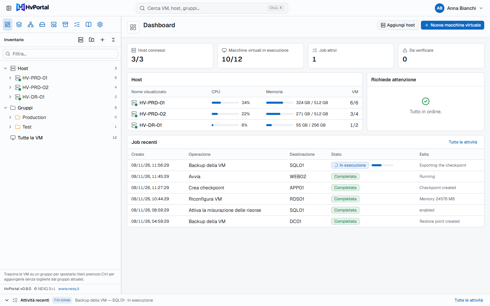
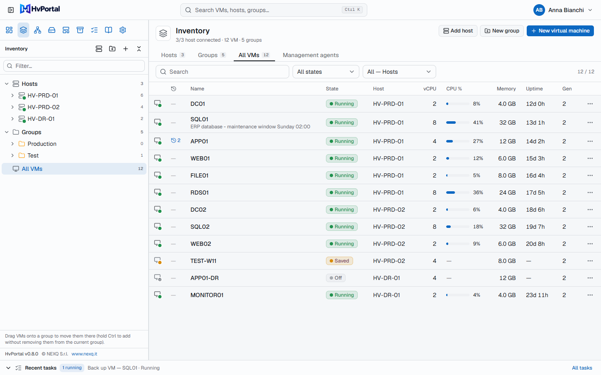
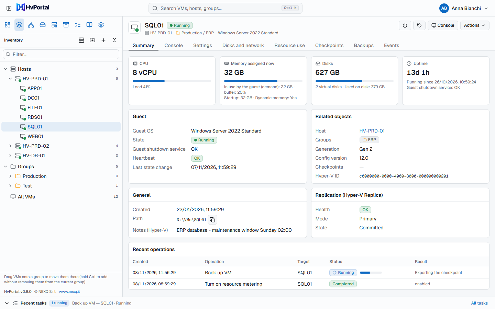
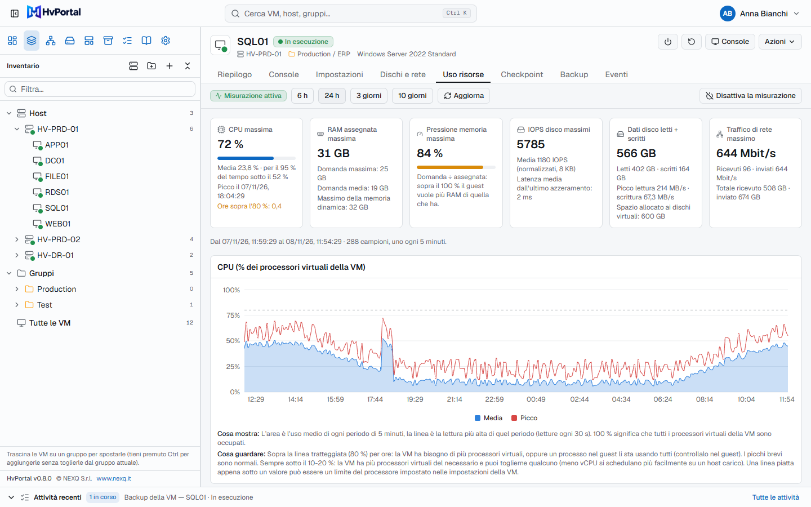
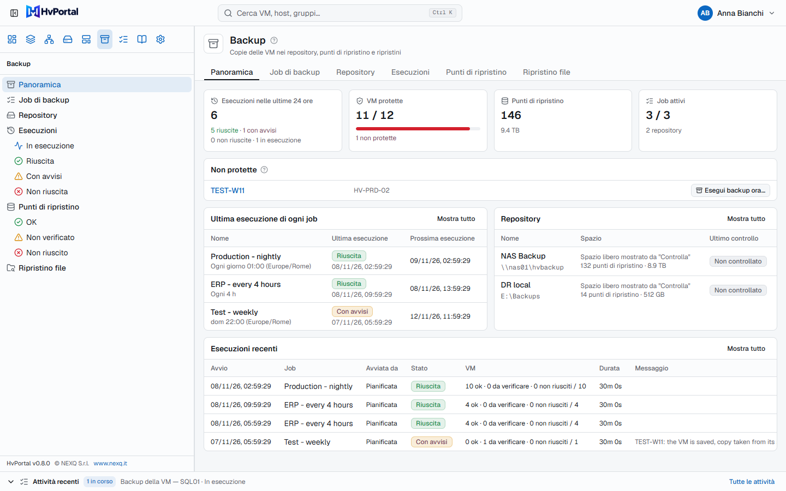
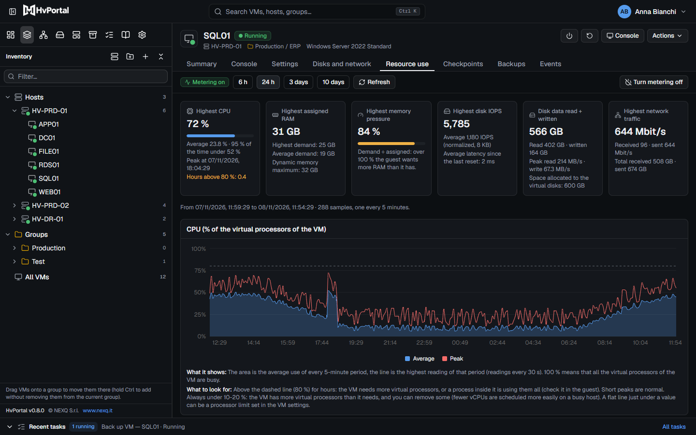
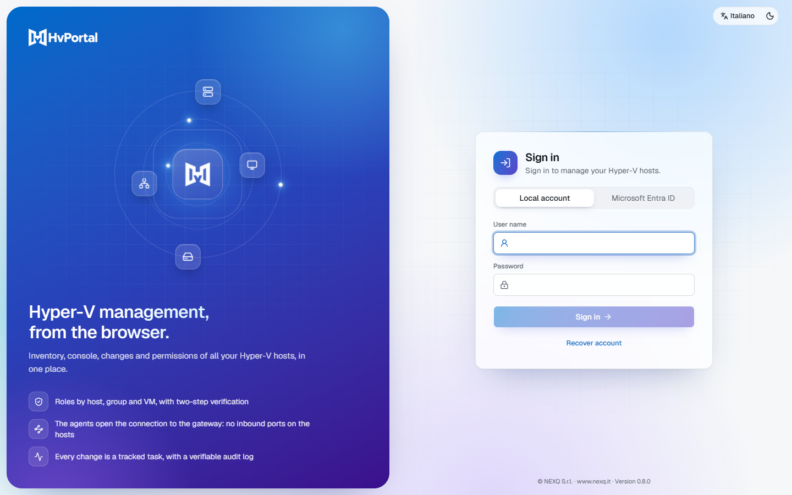
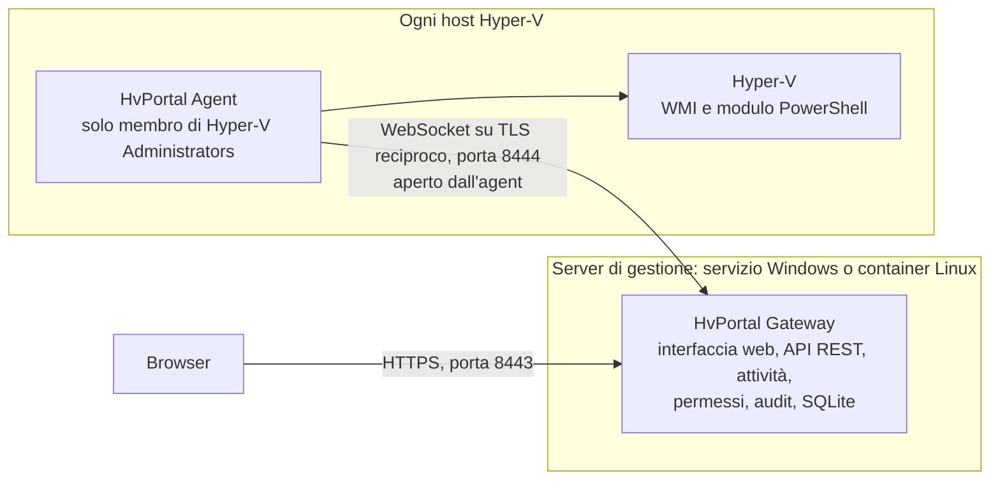

<p align="center">
  <picture>
    <source media="(prefers-color-scheme: dark)" srcset="assets/brand/Logo_HvPortal_White.png">
    
  </picture>
</p>

<h3 align="center">La console web che mancava ai tuoi host Hyper-V.</h3>

<p align="center">
  Inventario, console nel browser, modifiche alle VM, template, backup, storico delle risorse e permessi granulari<br>
  per tutti i tuoi host Hyper-V, da un unico portale installato da te. Niente System Center, niente Domain Admin, nessuna porta in ingresso sugli host.
</p>

<p align="center">
  <a href="https://github.com/NEXQsrl/HvPortal/releases/latest"><b>Scarica l'ultima release</b></a> ·
  <a href="#installazione-in-dieci-minuti">Installazione</a> ·
  <a href="#funzionalità">Funzionalità</a> ·
  <a href="INSTALL_IT.md">Guida completa</a> ·
  <a href="README.md">English</a>
</p>

<p align="center">
  
  
  
  
  <a href="LICENSE"></a>
  
</p>

<p align="center">
  
</p>

## Perché HvPortal

Hyper-V è un ottimo hypervisor, ma gestirne più di un paio di host di solito significa Hyper-V Manager su una
macchina di salto, script PowerShell, un prodotto di backup separato e amministratori con molti più diritti del
necessario. HvPortal dà a Hyper-V quello che gli amministratori VMware hanno con vCenter:

- **Un solo posto per tutti gli host e le VM.** Un inventario aggiornato di tutti gli host, in dominio o in workgroup,
  con console, impostazioni e storico di ogni VM a un clic.
- **Delega in sicurezza.** Dai a un team la sua cartella di VM, con quote e con gli host, le reti e lo storage che può
  usare. I ruoli si assegnano per host, gruppo o VM; nessuno può concedere più diritti di quelli che ha.
- **Ogni modifica è tracciata.** Ogni operazione è un'attività autorizzata, validata, seguita fino alla fine e scritta
  in un log di audit a prova di manomissione. Un esito che non si può verificare è mostrato come tale, mai come un
  successo.
- **Backup inclusi.** Backup pianificati delle VM su NAS o cartella locale, copie verificate, test di ripristino
  automatici, ripristino di un'intera VM, di un disco o di singoli file.
- **Anche i cluster di failover.** In workgroup o in dominio, con o senza Storage Spaces Direct: un agent su ogni
  nodo, così il portale continua a funzionare se un nodo o il suo agent sono fermi. Stato del cluster, capacità in caso
  di perdita di un nodo, manutenzione sicura dei nodi e VM altamente disponibili.
- **Sai davvero cosa usano le tue VM.** Dieci giorni di storico di CPU, memoria, dischi e rete per ogni VM, con grafici
  che spiegano cosa guardare.
- **Costruito sul minimo privilegio.** L'agent su ogni host è solo membro di *Hyper-V Administrators*, apre lui la
  connessione (nessuna porta in ingresso sull'host) e accetta solo un insieme chiuso di comandi tipizzati: dal portale
  non si può eseguire uno script arbitrario.

## Guardalo

<table>
  <tr>
    <td width="50%"><br><b>Inventario</b>: tutte le VM di tutti gli host, con stato, carico, memoria e uptime. Host, cartelle e tutte le VM in un unico albero.</td>
    <td width="50%"><br><b>Pagina della VM</b>: riepilogo, console nel browser, impostazioni, dischi e rete, checkpoint, backup ed eventi.</td>
  </tr>
  <tr>
    <td width="50%"><br><b>Uso risorse</b> (novità della 0.8.0): picchi e medie, poi grafici spiegati di CPU, memoria, pressione, IOPS, throughput e rete.</td>
    <td width="50%"><br><b>Backup</b>: VM protette, ultima esecuzione di ogni job, repository, punti di ripristino e ripristino file.</td>
  </tr>
  <tr>
    <td width="50%"><br><b>Tema chiaro e scuro</b>, italiano e inglese, guide passo passo integrate.</td>
    <td width="50%"><br><b>Accesso</b> con account locali e verifica in due passaggi, oppure con Microsoft Entra ID.</td>
  </tr>
</table>

<sub>Le immagini mostrano l'interfaccia reale della versione 0.8.0 con dati di esempio (host, VM e valori sono esempi).</sub>

## Funzionalità

### Inventario, console e stato
- **Inventario aggiornato** di tutti gli host: stato, vCPU e carico, memoria e domanda, uptime, heartbeat, sistema
  operativo guest, note, stato di Hyper-V Replica. Le modifiche fatte da Hyper-V Manager o PowerShell vengono rilevate e
  registrate.
- **Console nel browser**: lo schermo della VM come lo vede Hyper-V, con tastiera e mouse, anche prima che parta il
  sistema operativo e senza rete nel guest. È la console di Hyper-V, non una sessione RDP (pochi fotogrammi al secondo,
  niente audio né appunti: [dettagli](docs/console.md)).
- **Salute degli host**: hardware, dischi fisici, volumi e spazio libero, storage pool, schede di rete, errori hardware
  recenti e servizi di Hyper-V. Ciò che non si riesce a leggere è mostrato come sconosciuto, mai come sano.
- **Storico dell'uso delle risorse** (0.8.0): misurazione delle risorse di Hyper-V attivata dalla pagina della VM, un
  campione ogni 5 minuti conservato per 10 giorni, card con i picchi (CPU, RAM, pressione della memoria, IOPS, dati
  disco, rete) e sei grafici, ognuno con *cosa mostra* e *cosa guardare*.

### Cluster di failover (0.9.0)
- **Un agent per nodo, nessun punto unico di guasto**: il cluster viene letto e gestito tramite qualsiasi nodo il cui
  agent è connesso. Funzionano anche i cluster in workgroup (punto di accesso DNS): nessun account di dominio, nessuna
  credenziale memorizzata.
- **Stato del cluster con cosa fare**: nodi, quorum e witness, reti del cluster, volumi condivisi (spazio libero,
  accesso reindirizzato), Storage Spaces Direct (pool, volumi, dischi fisici, riparazioni in corso), ruoli e risorse in
  errore; controllato ogni 2 minuti, con e-mail o webhook quando peggiora.
- **Capacità in caso di perdita di un nodo**: se le VM altamente disponibili di ogni nodo stanno sugli altri (memoria),
  vCPU per core con un nodo fermo, riserva del pool S2D.
- **Manutenzione dei nodi**: svuotamento più manutenzione storage, e rientro con failback facoltativo. Rifiutata quando
  il cluster non può fare a meno del nodo (altro nodo fermo, riparazioni in corso, witness non disponibile, VM che non ci
  starebbero).
- **Nuove VM sul nodo che scegli** (con un suggerimento), **altamente disponibili** su un volume condiviso del cluster;
  spostamenti tra nodi tramite il cluster; le VM spostate da un failover mantengono gruppi, permessi e storico.

### Macchine virtuali
- **Alimentazione**: avvio, arresto e riavvio del guest, spegnimento, reset, pausa, ripresa, salvataggio.
- **Procedura guidata di creazione**: generazione 1 o 2, CPU, memoria, dischi, rete e VLAN, ISO, Secure Boot e TPM
  virtuale, posizione scelta con un selettore di cartelle.
- **Impostazioni**: CPU, memoria statica o dinamica, firmware, dischi nuovi ed espansi, DVD/ISO dalla libreria
  dell'host, schede di rete, nome e note. Ciò che Hyper-V non può cambiare su una VM accesa viene rifiutato, con il
  motivo.
- **Checkpoint**, **template** (una copia dei dischi di una VM preparata; le nuove VM hanno nome e risorse proprie) e
  **spostamenti** (live migration su un altro host, con o senza storage, oppure spostamento dello storage sullo stesso
  host).
- **Eliminazione** di una VM tenendo i dischi, oppure cancellando anche i file dei dischi, senza mai toccare file usati
  da altre VM.

### Gruppi, permessi e limiti
- **Cartelle di VM** annidate, riportate sugli host come gruppi di VM nativi di Hyper-V.
- **Accesso basato sui ruoli**: ambito globale, cluster, host, gruppo o VM; tutto negato per default, il divieto esplicito vince.
  Ruoli predefiniti da *Amministratore della piattaforma* a *Sola lettura*, più ruoli personalizzati.
- **Limiti per cartella**: quote (VM, vCPU, memoria, disco, reti private) e gli host, le reti e i percorsi di storage
  che la cartella può usare, controllati alla richiesta e di nuovo all'esecuzione.

### Reti e storage
- **Switch virtuali** (External, Internal, Private) e **reti con VLAN**: scegli una rete e switch e VLAN seguono;
  cambia la VLAN di una rete e ritagga le schede già collegate.
- **File degli host**: sfoglia, scarica, carica con verifica SHA-256. Le **cartelle storage** scelte all'installazione
  dell'agent limitano ciò che il portale può vedere su un host.

### Backup
- **Repository** su NAS o condivisione SMB (anche fuori dominio, con credenziali salvate) o in una cartella locale.
- **Job** per VM e cartelle: giornalieri, orari o manuali, con conservazione, verifica delle copie (SHA-256) e notifiche.
- **Ripristino** come nuova VM o sopra l'originale, di un disco, o di singoli file da un disco montato in sola lettura.
- **Test di ripristino**: un punto di ripristino viene ripristinato isolato, avviato, controllato tramite l'heartbeat
  del guest e poi eliminato.
- Basati su checkpoint ed esportazioni di Hyper-V, nessun software in più sugli host o sul NAS. HvPortal dice quale tipo
  di checkpoint Hyper-V ha usato davvero e non promette backup coerenti a livello applicativo
  ([come funziona](docs/backup-restore_IT.md)).

### Gestione e integrazione
- **Notifiche** via e-mail, Microsoft Teams, Slack o webhook; **token API di sola lettura** per i sistemi di
  monitoraggio; **API REST** con OpenAPI ([docs/api.md](docs/api.md)).
- **Aggiornamento degli agent dal portale** per le release firmate, accettato solo se firmato dallo stesso editore.
- **Host senza agent** (facoltativo), tramite un agent di gestione con credenziali salvate.
- **Backup del portale stesso** dalle Impostazioni, più copie automatiche giornaliere del suo database.

### Accesso e audit
- **Account locali** con passphrase e verifica in due passaggi (app di autenticazione, codici di recupero), oppure
  **Microsoft Entra ID**. Le azioni sensibili chiedono una conferma; un browser lasciato incustodito viene disconnesso
  dopo 15 + 3 minuti.
- **Log di audit** di ogni modifica e di ogni tentativo rifiutato, concatenato con HMAC così che le modifiche alle voci
  salvate si possano rilevare; verificabile ed esportabile.

## Installazione in dieci minuti

Ti servono un Windows Server per il portale (il **gateway**, che può girare anche come container Linux) e l'**agent**
su ogni host Hyper-V. Gli host hanno bisogno solo di poter raggiungere il gateway in uscita.

**1. Scarica** `HvPortal.Gateway.Setup.exe` e `HvPortal.Agent.Setup.exe` dall'[ultima release](https://github.com/NEXQsrl/HvPortal/releases/latest).
Le note della release riportano il loro SHA-256: controllalo con `Get-FileHash <file> -Algorithm SHA256`.

**2. Rendi attendibile la firma (una volta per server).** I file sono firmati da *NEXQ S.r.l.* con un certificato
self-signed, che Windows considera attendibile solo dopo che l'hai importato. Il certificato pubblico è dentro la firma
del file: estrailo, controlla che l'impronta sia `989A5C82203AB19B6DB29FC447E8CB5EBEEB60D8` e importalo (PowerShell da
amministratore):

```powershell
$cert = (Get-AuthenticodeSignature .\HvPortal.Gateway.Setup.exe).SignerCertificate
$cert.Thumbprint          # deve essere 989A5C82203AB19B6DB29FC447E8CB5EBEEB60D8
Export-Certificate -Cert $cert -FilePath .\HvPortal-CodeSigning.cer | Out-Null
Import-Certificate -FilePath .\HvPortal-CodeSigning.cer -CertStoreLocation Cert:\LocalMachine\Root
Import-Certificate -FilePath .\HvPortal-CodeSigning.cer -CertStoreLocation Cert:\LocalMachine\TrustedPublisher
```

Anche senza questo passaggio i setup partono (*Ulteriori informazioni > Esegui comunque*), ma serve per aggiornare gli
agent dal portale. Una firma self-signed non dà alcuna reputazione presso SmartScreen o gli antivirus.

**3. Installa il gateway.** Avvia `HvPortal.Gateway.Setup.exe` sul server di gestione e indica i nomi e gli indirizzi
che useranno browser e agent (porta del portale 8443, porta degli agent 8444). Alla fine il setup mostra l'indirizzo
del portale e un **token di configurazione monouso**.

**4. Primo accesso.** Apri l'indirizzo (con il certificato interno il browser avvisa una volta, vedi
[INSTALL_IT.md](INSTALL_IT.md#4-certificato-del-portale-e-nomi)), inserisci il token, crea l'amministratore e
registra un'app di autenticazione. Non esistono credenziali predefinite.

**5. Aggiungi un host.** Nel portale scegli **Aggiungi host > Agent sull'host** e copia la riga *Dati per il setup*
(vale 15 minuti).

**6. Installa l'agent.** Avvia `HvPortal.Agent.Setup.exe` sull'host Hyper-V, premi **Incolla dal portale** e scegli
quali cartelle locali il portale può usare. L'host compare online in pochi secondi.

**7. Invita il tuo team.** In **Utenti e ruoli** crea gli utenti (locali o Microsoft) e assegna i ruoli su host,
cartelle o VM. I nuovi utenti non hanno permessi finché non glieli dai.

**Aggiornamenti**: avvia il nuovo setup del gateway sul gateway, poi aggiorna gli agent dal portale (*Guida >
Aggiornare i servizi Windows*) o con il nuovo setup dell'agent. Tutto il resto, compresi gli script per le installazioni automatiche,
Docker, il tuo certificato, i prerequisiti per backup e live migration, è in **[INSTALL_IT.md](INSTALL_IT.md)**.

### Requisiti

| Componente | Requisito |
|---|---|
| Gateway | Windows Server a 64 bit (autonomo, nessun .NET da installare; il setup grafico richiede .NET Framework 4.7.2, incluso da Windows Server 2019), oppure un host Docker Linux (`linux/amd64`) |
| Host Hyper-V | Windows Server con il ruolo Hyper-V e il suo modulo PowerShell; TCP in uscita verso la porta degli agent del gateway. Non serve essere in dominio. |
| Cluster di failover | L'agent su ogni nodo, installato con `-ClusterAccess Full` (o *Nodo di un cluster di failover* nel setup); il modulo PowerShell del Failover Clustering sui nodi ([guida di installazione](INSTALL_IT.md#5i-cluster-di-failover-anche-in-workgroup-con-o-senza-storage-spaces-direct)) |
| Browser | Edge, Chrome o Firefox aggiornati |
| Internet | Non necessario. Lo usa solo ciò che attivi: accesso con Entra ID, SMTP, webhook |

Windows Server 2025 è la piattaforma di riferimento, la 2022 è in valutazione: vedi la
[matrice di compatibilità](docs/compatibility-matrix.md).

## Come funziona



- Il **gateway** gira con un account di servizio non amministratore (`NT SERVICE\HvPortalGateway`) o in un container
  non root, e contiene interfaccia web, API, attività, permessi, audit e database.
- L'**agent** gira su ogni host come `NT SERVICE\HvPortalAgent`, solo membro di *Hyper-V Administrators*, e si collega
  al gateway con TLS reciproco e certificati di una CA interna.
- I comandi sono **chiusi e tipizzati**: WMI per inventario, alimentazione e console; un unico script PowerShell fisso
  con parametri tipizzati per le operazioni di gestione.

Approfondimenti: [architettura](docs/architecture.md), [decisioni di progetto](docs/decisions.md),
[modello di sicurezza](docs/security-model.md).

## Stato del progetto

HvPortal 0.9.0 è un'**anteprima**. Ha un'ampia suite di test automatici; le operazioni che richiedono un host Hyper-V
reale sono provate contro un sostituto di prova dell'agent, e le verifiche ancora da fare su host reali sono elencate
nel [piano di test sugli host reali](docs/verification/real-host-test-plan.md). Comincia in laboratorio o su host non
critici, e non esporre il portale né la porta degli agent su Internet. HvPortal non ha ancora avuto una revisione di
sicurezza indipendente. Il supporto ai cluster di failover (0.9.0) non è ancora stato verificato su un cluster reale
(piano di test V72–V80).

## Documentazione

| Argomento | Documento |
|---|---|
| Installazione, aggiornamenti, disinstallazione | [INSTALL_IT.md](INSTALL_IT.md), tutte le opzioni in [docs/install.md](docs/install.md) |
| Gateway in un container Linux | [docker/README.md](docker/README.md) |
| Backup e ripristini, backup del portale | [docs/backup-restore_IT.md](docs/backup-restore_IT.md) |
| Risoluzione dei problemi | [docs/troubleshooting.md](docs/troubleshooting.md) |
| Sicurezza | [SECURITY_IT.md](SECURITY_IT.md), [docs/security-model.md](docs/security-model.md), [docs/threat-model.md](docs/threat-model.md) |
| API REST | [docs/api.md](docs/api.md), [docs/openapi/v1.json](docs/openapi/v1.json) |
| Architettura e decisioni | [docs/architecture.md](docs/architecture.md), [docs/decisions.md](docs/decisions.md) |
| API di Hyper-V e privilegi | [docs/capability-matrix.md](docs/capability-matrix.md) |
| Test e verifica su host reali | [docs/testing.md](docs/testing.md), [docs/verification/real-host-test-plan.md](docs/verification/real-host-test-plan.md) |
| Licenze di terze parti | [docs/licensing.md](docs/licensing.md) |

I documenti in `docs/` sono in inglese, tranne dove indicato.

## Compilare dai sorgenti

Prerequisiti: Windows 10/11 o Windows Server, .NET SDK 10.0.204 (fissato da `global.json`), Node.js 22+, PowerShell 7.

```powershell
cd web; npm ci; npm run build; npx vitest run; cd ..     # interfaccia web, scritta in src\HvPortal.Gateway\wwwroot
dotnet build HvPortal.slnx
dotnet test HvPortal.slnx
.\scripts\dev\Start-DevGateway.ps1 -Reset                  # gateway di sviluppo su https://localhost:18443
.\installer\Build-Release.ps1                              # release: artifacts\release\<versione>\ (setup inclusi)
```

Le build firmate e la pubblicazione su GitHub sono descritte in [INSTALL_IT.md](INSTALL_IT.md#1-procurarsi-i-file-della-release),
l'immagine del container in [docker/README.md](docker/README.md), le suite di test in [docs/testing.md](docs/testing.md).

## Sicurezza

Minimo privilegio ovunque: account di servizio non amministratori, agent che aprono la connessione su TLS reciproco,
un insieme chiuso di comandi tipizzati, tutto negato per default, segreti cifrati o salvati solo come hash, un log di
audit concatenato. Nessuna telemetria: il gateway contatta servizi esterni solo per ciò che configuri (Entra ID, il tuo
server SMTP, i tuoi webhook). **Per segnalare una vulnerabilità non aprire una issue pubblica**: segui
[SECURITY_IT.md](SECURITY_IT.md).

## Contribuire

Leggi prima [CONTRIBUTING.md](CONTRIBUTING.md). In breve: non riportare mai un risultato non verificato, autorizza ogni
endpoint sul server (con un test per il rifiuto), non aggiungere mai un modo per eseguire script arbitrari sugli host,
non mettere mai segreti nei log e tieni ogni testo visibile all'utente sia in italiano sia in inglese.

## Licenza

HvPortal è sviluppato da [NEXQ](https://www.nexq.it) e distribuito con la
**[PolyForm Shield License 1.0.0](https://polyformproject.org/licenses/shield/1.0.0)** ([LICENSE](LICENSE), testo in
inglese), una licenza standard *source available*:

- **Gratuito per uso personale e aziendale**, anche in produzione, senza limiti di utenti, host Hyper-V, macchine
  virtuali o installazioni.
- **Il codice sorgente è pubblico**: puoi studiarlo, modificarlo e usarlo come base, e distribuirne copie insieme alla
  licenza e alla riga `Required Notice`.
- **La rivendita non è consentita**: la licenza vieta di offrire prodotti in concorrenza con HvPortal, quindi non si
  può venderlo, vendere versioni modificate o rinominate, né offrirlo come prodotto o servizio concorrente.
- **Diritti commerciali aggiuntivi**: contatta NEXQ tramite [www.nexq.it](https://www.nexq.it).

Non è una licenza open source approvata dall'OSI (GitHub la mostra come "Other"). I componenti di terze parti
mantengono le proprie licenze: vedi [NOTICE](NOTICE) e [docs/licensing.md](docs/licensing.md), che spiega anche come
il divieto di concorrenza si applica ai servizi a pagamento.

Copyright (c) NEXQ S.r.l. · [www.nexq.it](https://www.nexq.it)

"Hyper-V", "Windows Server" e "Microsoft Entra" sono marchi del gruppo di società Microsoft. HvPortal è un progetto
indipendente, non affiliato né approvato da Microsoft.
